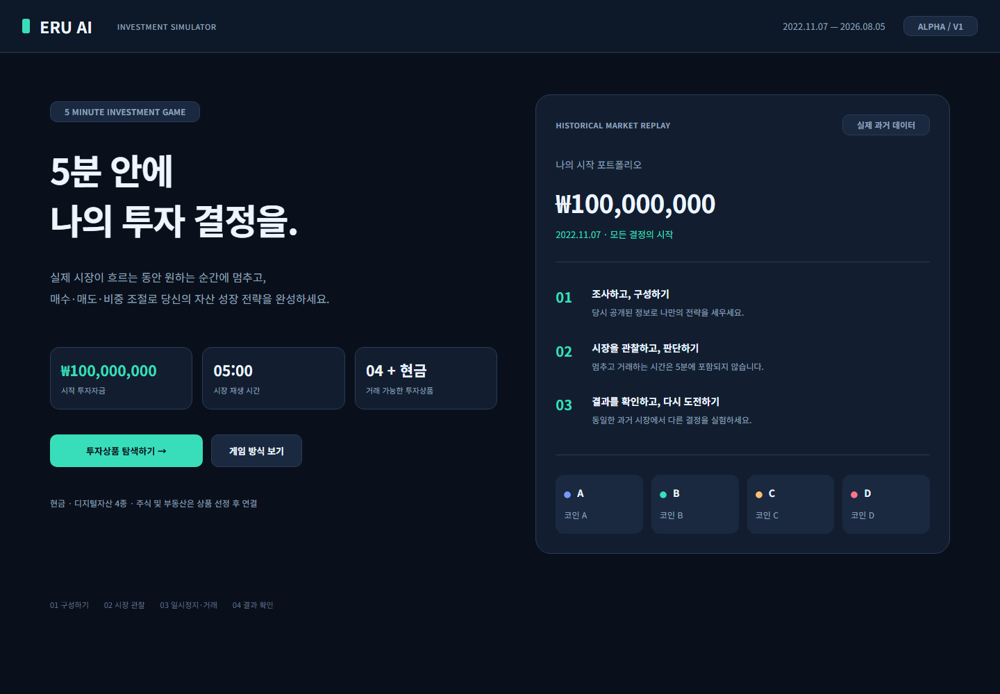

# ERU AI Investment Simulator · Alpha V1

Windows PC에서 실제 과거 시세로 플레이하는 5분 투자 시뮬레이터입니다. 기존 V2 자료는 원본과 `archive/ERU_AI_Investment_Simulator_V2/`에 보존했습니다.

## 확인 및 공유 링크

| 확인할 내용 | 링크 |
|---|---|
| 이 PC에서 실제 플레이 | **[ERU AI Alpha V1 열기](http://127.0.0.1:8000)** |
| 서버 실행 상태 확인 | [상태 확인](http://127.0.0.1:8000/api/health) — 정상일 때 `status: ready` |
| README 공유 | [GitHub 프로젝트 안내](https://github.com/kimue7057/Investment_project_ERU_AI#readme) |
| 실제 테스트 결과 | [Alpha V1 구현·검증 보고](docs/Alpha_V1_검증_보고.md) |
| 실제 시세 검증 결과 | [데이터 검증 JSON](data/metadata/validation.json) |
| 기존 디자인 | [Figma 18개 화면](https://www.figma.com/design/8hP2vt56sOezV4kF0mAdzI) |

**플레이 링크는 서버를 실행한 Windows PC에서 접속하는 로컬 주소입니다.** 다른 사람에게 GitHub README 링크를 공유하면 안내와 아래 화면을 확인할 수 있습니다. 다른 PC에서 직접 플레이하려면 저장소를 내려받고 해당 PC에서 설치·실행해야 합니다. 인터넷에서 누구나 접속하는 공개 데모 주소는 아직 없습니다.



위 이미지는 실제로 실행한 Alpha V1의 시작 화면입니다. 시작 자금과 게임 절차를 표시하며 예시 투자 수익률을 넣지 않았습니다.

## 바로 실행

1. Windows 파일 탐색기에서 이 프로젝트 폴더를 엽니다.
2. **`RUN_ERU_AI.cmd`를 더블클릭**합니다. 이 PC에는 개발 환경, 검증된 시세 및 프론트엔드 빌드가 준비되어 있습니다.
3. 자동으로 열린 브라우저 또는 **[플레이 링크](http://127.0.0.1:8000)**에서 `투자상품 탐색하기 →`를 누릅니다.

화면을 확인하려면 상품 정보를 열어본 뒤 비중 합계를 100%로 설정하고 `투자 시작 →`를 누릅니다. 시장을 일시정지해 매수·매도·비중 조정을 주문한 뒤 다시 재생하면 실제 잔고와 보유량이 갱신됩니다.

접속이 안 되면 `RUN_ERU_AI.cmd`를 실행한 뒤 [상태 확인](http://127.0.0.1:8000/api/health)을 다시 엽니다. 실행·설치·종료 파일의 소스는 [RUN_ERU_AI.cmd](RUN_ERU_AI.cmd), [SETUP_ERU_AI.cmd](SETUP_ERU_AI.cmd), [STOP_ERU_AI.cmd](STOP_ERU_AI.cmd)에서 확인할 수 있습니다. GitHub에서 실행 파일 링크를 누르면 내용이 표시되므로, 실행은 내려받은 프로젝트의 파일 탐색기에서 진행하세요.

새 PC에서는 `SETUP_ERU_AI.cmd`를 먼저 실행합니다. Python 3.12 이상, Node.js 22.12 이상 및 pnpm 11이 필요합니다. Codex가 제공하는 런타임이 있으면 자동으로 사용합니다. 최초 설치·실제 시세 수집에는 인터넷이 필요합니다.

종료할 때 `STOP_ERU_AI.cmd`를 실행합니다. 게임은 SQLite에 저장됩니다. 서버를 다시 실행하면 재생 중이던 게임도 일시정지 상태로 복원됩니다. 브라우저의 저장된 게임을 계속하거나 결과 화면에서 재도전할 수 있습니다.

## 플레이

1. 투자상품을 탐색하고 기술·공급·위험 및 당시 공개된 자료를 확인합니다.
2. 현금과 코인 A~D의 비중 합계를 100%로 맞춰 투자합니다.
3. **2022.11.07 00:00 KST → 2026.08.05 23:59:59 KST**를 시장 재생 **300초**에 압축합니다.
4. 언제든 정지하고 매수·매도 또는 리밸런싱을 주문합니다. 판단 중에는 시장시간이 정지합니다.
5. 시장을 재개하면 **주문 시각보다 엄격히 뒤인 다음 일봉 시가(09:00 KST)**에 체결됩니다.
6. 종료 후 수익률, 최대 낙폭, 거래 이력, AI 선택 및 초기 배분 유지 전략과의 비교를 확인하고 실제 자산명을 공개합니다.

초기 자금은 100,000,000원이며 추가 입출금은 없습니다. 주식 E/F 및 부동산 G는 미확정 상태로 표시하고 거래를 차단합니다.

## 체결·평가 규칙

- 거래대금의 **0.05%**를 수수료로 가정합니다. 실제 계정의 수수료를 재현하는 값이 아닌 Alpha의 고정 모델입니다. 슬리피지는 가정하지 않습니다.
- 매수 금액은 수수료 포함 예산입니다. 100% 매수도 잔고를 초과하지 않습니다.
- 금액 매도는 주문 당시 관측 가격으로 수량을 정하고 다음 시가에 매도합니다. 비율 매도는 보유 수량 기준입니다. 체결 금액은 관측 시점의 예상 금액과 달라질 수 있습니다.
- 동시에 하나의 대기 주문/리밸런싱만 허용합니다. 대기 주문은 정지 중 취소할 수 있습니다. 초기 배분 주문은 취소할 수 없습니다.
- 목표 비중 저장과 리밸런싱 주문은 별개입니다. 리밸런싱은 같은 다음 시가에서 매도 후 매수하고, 수수료 차감 후 총자산을 기준으로 목표 비중을 계산합니다.
- 현재 평가는 이미 공개된 가장 최근 종가 또는 이미 시작된 일봉 시가를 사용합니다. **진행 중 일봉의 고가·저가·종가·거래량은 제공하지 않습니다.**
- 업비트 UTC 날짜 D의 일봉은 D+1일 09:00 KST에 확정됩니다. 따라서 종료일까지 수집한 2026.08.05 일봉의 종가는 게임 종료 때에도 숨기며, 차트의 마지막 확정 일봉은 **2026.08.04**입니다.
- MDD는 일별 평가점과 자료 공개 평가점의 자산 곡선으로 계산합니다. 일중 틱 기준 MDD는 아닙니다. 보유 자산은 종료 시가로 평가하며 강제 청산 수수료를 추가로 가정하지 않습니다.
- 규칙 기반 리스크 가드는 완료된 주봉, 확정된 일봉 급락, 집중도와 현금 여력을 관찰해 분할 매수·매도를 제안합니다. 알림에 자동 정지하며 수용·비율 수정·무시를 기록합니다. 자연어 생성형 AI 서비스 연결은 포함하지 않습니다.

## 실제 데이터

공식 업비트 KRW 일봉을 로컬에 수집했습니다. 자산별 **1,592행 = 게임 구간 1,368행 + 준비 구간 224행**, 누락·중복·OHLCV·통화·공개 시각 검증 및 SHA256 검사 통과. 수집 구간: 2022.03.28~2026.08.05.

- `data/raw/upbit/`: API 원본 페이지. Git에서 제외합니다.
- `data/normalized/`: 서버용 정규화 CSV. Git에서 제외합니다.
- `data/metadata/validation.json`: 검증 결과 및 해시. 서버 시작 시 CSV 해시를 재확인합니다.
- `data/metadata/first_history_PRIVATE.json`: API에서 확인 가능한 최초 일봉 감사. 실제 장중 상장 시각을 의미하지는 않습니다.
- `data/sources/source_events_PRIVATE.json`: 실제 발표 시각과 익명 요약을 담은 서버 전용 자료.

실제 식별자·원문 링크·미래 자료의 존재 및 가격은 종료 전 API에서 보내지 않습니다. 정적 웹 서버는 `frontend/dist`만 제공합니다. 가격·시간·체결·잔고는 서버가 관리하며 브라우저의 날짜를 신뢰하지 않습니다.

이 앱은 **로컬 내부 검토용 Alpha**입니다. 시세 데이터와 문서의 공개 재배포·상업 이용 허가는 확보하지 않았으므로 공개 호스팅/상업 배포는 별도 라이선스 확인 후 진행해야 합니다. 원본 데이터는 Git에 넣지 않았습니다. [공식 일봉 API 문서](https://docs.upbit.com/kr/reference/list-candles-days), [Open API 약관 개정 안내](https://docs.upbit.com/kr/changelog/open_api_agreement_revision)를 확인했습니다. 문서 원문은 배포하지 않고 요약만 제공합니다.

## 개발·검증

```powershell
# 새 환경 구성 및 빌드
powershell -ExecutionPolicy Bypass -File scripts/SETUP.ps1

# 프론트엔드 수정 후 타입 검사·테스트·빌드
powershell -ExecutionPolicy Bypass -File scripts/BUILD.ps1

# 백엔드 테스트
& "$env:LOCALAPPDATA\ERU-AI\alpha-v1-venv\Scripts\python.exe" -m pytest tests -q

# 데이터 재검증 / 필요시 재수집
& "$env:LOCALAPPDATA\ERU-AI\alpha-v1-venv\Scripts\python.exe" scripts/validate_data.py
& "$env:LOCALAPPDATA\ERU-AI\alpha-v1-venv\Scripts\python.exe" scripts/collect_upbit.py

# 기존 패키지 테스트는 원래 폴더에서 별도로 실행
Push-Location archive/ERU_AI_Investment_Simulator_V2
& "$env:LOCALAPPDATA\ERU-AI\alpha-v1-venv\Scripts\python.exe" -m unittest discover -s tests -v
Pop-Location
```

브라우저 전체 테스트는 로컬 서버 실행 후 `node scripts/browser_smoke.cjs`로 실행합니다. Playwright가 필요하며 `ERU_PLAYWRIGHT_PATH`에 설치 경로를 지정할 수 있습니다. Codex 번들 설치는 자동 탐색합니다. 실제 300초 재생과 수동 주문, 자료 공개, 정체 비공개, 결과·재도전까지 검사합니다. 결과 및 스크린샷은 Git에서 제외된 `test-results/`에 저장합니다.

## 구성 및 저장 위치

- `frontend/src/`: React / TypeScript / Lightweight Charts 화면.
- `backend/app/`: FastAPI, 실제 데이터 차단 경계, Decimal 장부 및 서버 재생 엔진.
- `scripts/`: 수집·검증·Windows 설치/빌드/실행 및 브라우저 검증.
- `tests/`: 실제 데이터 기반 장부·API·미래정보 방지 회귀 테스트. 인공 시세를 실제 플레이 데이터로 만들지 않습니다.
- `docs/`: 인수인계 분석, 설계, 데이터·디자인 감사, 검증 보고.
- `%LOCALAPPDATA%\ERU-AI\`: Python 환경, Node 의존성 및 빌드 캐시, 서버 PID·로그. Google Drive에서 Node 심볼릭 링크 설치 충돌을 방지합니다.
- `data/runtime/sessions.sqlite3`: 로컬 게임 저장 파일. Git에서 제외합니다. 게임을 플레이하는 동안 이 파일을 다른 PC에서 동시에 사용하지 마세요.

소스의 기준은 이 프로젝트 폴더입니다. 캐시의 소스를 직접 수정하지 마세요. `BUILD.ps1`이 소스를 캐시에 복사하고 빌드 결과를 되돌립니다. `.git`은 Drive 동기화 경로에 있으므로 여러 PC에서 동시에 Git 작업하지 말고, 충돌 발생 시 force push/초기화를 하지 말고 서버와 동기화 상태부터 확인하세요.

## 디자인 및 범위

기존 [Figma 18개 화면](https://www.figma.com/design/8hP2vt56sOezV4kF0mAdzI)을 검토했습니다. 배경·민트 강조·좌측 탐색·우측 자산/매매 패널을 적용했습니다. 예시 가격·성과 차트는 복사하지 않고 실제 서버 데이터로 대체했습니다. 미확정 E/F/G의 예시 비중은 비활성 처리했으며 작은 화면용 반응형 배치를 추가했습니다.

확장 대상으로 남은 항목은 E/F/G의 상품 확정과 라이선스 데이터 연결, 기술자료의 추가 역사 버전 확보, 생성형 AI 설명 연결, 실시간 주문장·슬리피지 모델 및 공개 서비스 운영입니다. 현재 Alpha는 일봉 기반의 재현 가능한 로컬 게임입니다.
