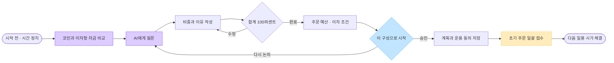
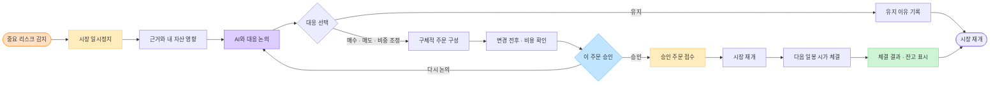
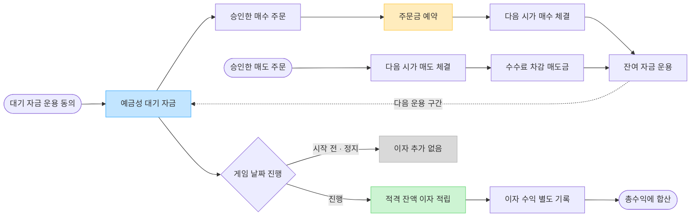

# ERU AI 사용자 플로우 V3 · AI와 계획하고 승인한 매매 자동 실행

개정일: 2026-10-20. 최신 사용자 지시로 이전의 ‘계획 저장 후 종목별 직접 매수’를 대체합니다. 초기 투자와 이후 대응 모두 AI와 논의하고, 사용자가 확정한 주문을 서버가 자동 실행하는 방향입니다.

**후속 구현: V3 개발·검증 진행.** 사용자가 Figma 작업 생략과 바로 개발·배포를 요청하여 앱에서 이 흐름을 구현했습니다. 실제 반영 범위·교육용 금리 정책·AI 연결 제한·배포 검증은 [V3 구현 기록](../AI_동행투자_V3_구현.md)을 기준으로 확인합니다. 아래 내용은 최초 설계안이며, 구현 전이라고 표현한 대목은 당시 기준입니다. FigJam의 기존 차트는 이번 작업에서 교체하지 않습니다.

- [FigJam 보드 — 현재 이전 안, V3 교체 대기](https://www.figma.com/board/wjkeaHXafNo8xfS1kHNjfp)
- [전체 흐름 원본](전체_흐름.mmd) · [초기 대화와 계획](초기_계획.mmd) · [가드 대응](가드_매매.mmd) · [대기 자금과 이자](대기_자금.mmd)
- [현재 배포 앱](https://eru-ai-investment-simulator.vercel.app)

## 1. 이번 흐름의 핵심

**자산 이해 → AI와 포트폴리오 구축 → 시작 승인 → 초기 자동 매매 → 시세·이자·가드 운용 → 위험 시 AI와 재논의 → 유지 또는 승인한 매매 자동 실행 → 선택과 성과 복기.**

자동매매는 사용자가 확정한 초기 구성과 이후 승인한 매수·매도·비중 조정 주문을 실행하는 기능입니다. 초기 구성의 승인이 향후 모든 AI 제안의 실행 권한이 되지는 않습니다. 목표 비중을 저장했다는 이유로 지속적으로 재조정하지 않으며, 정기 매매·무제한 AI 위임은 이번 범위에 포함하지 않습니다.

초기 1억 원, 게임 날짜 2022-11-07~2026-08-05, 활성 재생 300초를 유지합니다. AI와 대화하거나 주문을 확인하는 시간은 재생 시간에 포함하지 않습니다.

## 2. 전체 흐름

## 3. 시작 전: AI와 이해하고 구성하기

| 화면 | 사용자가 보는 것 | 행동과 결과 |
|---|---|---|
| 시작 | 1억 원, 과거 시장을 5분 동안 경험하는 방식, AI의 역할 | ‘AI와 투자 준비하기’ |
| 자산 이해 | 코인 A~D와 예금성 대기 자금의 특징·손실 가능성·유동성·비용·수익 발생 방식 | 카드를 비교하고 AI에게 질문 |
| 함께 계획 | 종목별 비중·금액, 대기 자금 비중, 선택 이유 | AI 제안의 근거를 확인하고 직접 수정 |
| 시작 확인 | 종목별 매수 예산, 수수료, 남길 자금, 이자 운용 조건, 체결 시점 | ‘이 구성으로 투자 시작’ |
| 초기 주문 | 접수된 종목·예산·상태, 남은 대기 자금 | 재생을 시작해 다음 일봉 시가에서 일괄 체결 |
| 체결 확인 | 실제 수량·체결가·수수료·실제 비중 | 초기 계획과 실제 구성을 함께 확인 |

초기 정보는 게임 시작 시점에 공개 가능한 자료만 사용합니다. 코인 카드는 자산의 용도·구조, 가격 변동 특성, 거래 비용과 유동성, 이자형 자금과의 차이를 설명합니다. A~D의 실제 식별자를 드러내는 설명은 공개 범위 검토를 거쳐야 하며, 특징을 설명하기 위해 실제 이름을 노출하지 않습니다.

AI 대화 예: ‘이 자산의 위험은 뭐야?’, ‘대기 자금을 남기는 이유는?’, ‘이 구성이 한 종목에 너무 몰렸어?’. AI가 만든 비중은 초안이며 사용자의 수정·확정 대상입니다. 질문을 더 하거나 이전 단계로 돌아가도 주문하지 않습니다.

코인 비중과 대기 자금 비중의 합계는 100%입니다. 코인별 금액은 **수수료를 포함한 지출 한도**로 정의해 1억 원 초과 주문을 방지합니다. 정확한 수량·체결 후 비중은 다음 시가에 따라 달라지므로 예상값과 실제값을 구분합니다. 대기 자금 100%도 유효한 계획이며 이때는 코인 주문 없이 운용을 시작합니다.

## 4. 운용 화면: 구성·이자·판단 기록이 중심

화면 상단에는 게임 날짜, 재생 상태, 총자산과 누적 손익을 둡니다. 본문은 다음 세 영역으로 구성합니다.

| 영역 | 핵심 정보 | 주요 행동 |
|---|---|---|
| 내 포트폴리오 | 종목별 평가액·손익·실제 비중·처음 목표, 대기 자금 | 자산 상세 보기, AI와 구성 다시 논의 |
| 대기 자금 | 운용 원금, 주문 예약금, 주문 가능 금액, 누적 이자, 적용 금리의 기준일과 운용 조건 | 이자 상세 확인 |
| AI 투자 기록 | 처음 계획 이유, 가드 근거, 대화와 선택, 주문·체결 결과 | AI와 논의, 승인 대기 주문 확인 |

종목 가격과 차트는 자산 상세에서 제공합니다. 기본 화면의 중심은 내가 정한 구성의 변화와 다음 판단입니다. 주식·부동산 준비 중, 새 투자 자료 공개 알림은 계속 제외합니다.

사용자가 먼저 AI 대화를 열어도 시장을 정지합니다. 대화를 닫거나 주문을 승인한 뒤에는 재생 상태를 명확히 알리고 시장을 재개합니다.

## 5. 리스크 가드: 설명 → 대화 → 선택 → 결과

중요 위험은 시장을 정지하고 ‘왜 멈췄는지’를 먼저 보여줍니다. 참고 신호는 운용 화면의 카드로 안내하며, 사용자가 논의를 열 때 정지합니다. 가드 분석은 기본 기능으로 유지하고, 사용자가 지표 임계값을 설정하는 화면을 앞에 두지 않습니다.

1. **근거:** 현재까지 확정된 시세에서 관찰한 변화와 판단 시점.
2. **내 자산 영향:** 어떤 보유 종목과 비중이 영향을 받는지.
3. **AI와 논의:** 유지, 일부 매도, 다른 자산 매수, 대기 자금 확대 등의 선택과 비용·위험을 비교.
4. **결정:** 유지하거나 구체적인 주문 초안을 선택·수정.
5. **승인:** 변경 전후 보유량·대기 자금·매매 비용·체결 시점을 확인하고 ‘이 주문 실행’.
6. **실행 확인:** 접수와 체결을 분리하고 실제 결과를 내 포트폴리오와 기록에 즉시 반영.

‘제안 수용’, ‘매도 비율 수정’만 단독으로 표시하지 않습니다. 예를 들어 **‘코인 A 보유 수량의 20% 매도’**처럼 대상과 기준을 먼저 쓰고, 예상 수량·대기 자금 변화·수수료를 함께 보여줍니다. 이 수치는 설명용 예시이며 가드의 기본 매도 비율을 확정한 것이 아닙니다.

유지는 주문 없이 이유를 기록하고 재생합니다. 승인 전에는 매매가 없으며, 제안 카드를 닫아도 매도하지 않습니다. 승인 취소·대기 주문 취소는 실제 체결 전까지만 가능하고, 변경안은 기존 미체결 주문을 조용히 덮어쓰지 않습니다. 반복 신호는 같은 사유로 계속 정지시키지 않도록 묶고 재알림 기준을 둡니다.

## 6. 미투자금의 수익: 예금성 대기 자금

이번 핵심 구성은 **코인 A~D + 이자가 발생하는 유동성 대기 자금**입니다. 미투자금은 사용자가 시작할 때 확인한 운용 규칙에 따라 이자형 자금으로 남고, 매도 대금도 수수료를 차감한 뒤 같은 자금으로 돌아갑니다. 승인한 매수 주문에는 이 중 사용 가능한 금액을 자동 사용합니다.

| 자금·자산 | 특성과 역할 | 이번 설계에서의 취급 |
|---|---|---|
| 예금성 대기 자금 | 기다리는 동안 이자를 얻고 승인한 매수에 사용 | 기본 운용 대상으로 포함 |
| 정기예금·적금 | 만기·납입·중도해지 조건을 별도로 고려 | 자산 이해 단계에서 차이를 설명; 실제 거래 추가에는 상품·기간·금리 자료 설계 필요 |
| 채권 | 이자와 별도로 시장 가격·신용·만기 위험을 고려 | 현금과 합치지 않음; 실제 거래 추가에는 별도 자산·시세·이자 지급 자료 필요 |
| 코인 | 가격 변동에 따른 손익과 거래 비용 발생 | 기존 검증 데이터 A~D 유지; 스테이킹 등 별도 수익을 자동 부여하지 않음 |

사용자 취지를 반영해 대기 자금의 수익은 반드시 포함하되, 현금을 보유했다고 자동으로 채권을 산 것으로 처리하지 않습니다. E/F/G를 채권·예금·적금으로 임의 확정하지 않습니다. 정기예금·적금을 추가하는 경우 기존 1억 원 안에서 이동하며 외부 추가 납입으로 자산이 늘지 않습니다. 만기가 있는 상품의 돈은 즉시 주문 가능한 잔고로 표시하지 않습니다. 준비 중인 상품 카드를 운용 화면에 나열하지 않습니다.

### 이자 계산 기준안

다음은 실상품 확정 전 **시뮬레이션 계산 방식 제안**입니다. 실제 금리 수치는 비워두며, 구현 전에 금리 자료와 과세·지급 조건을 확정해야 합니다.

- 실제 300초가 아니라 **게임에서 경과한 날짜**에 따라 계산합니다. 시작 전과 일시정지 중에는 게임 날짜가 흐르지 않아 이자가 추가되지 않습니다.
- 매일 체결·수수료·예약금을 반영한 뒤 이자 대상인 운용 가능 원금을 확정하고, 해당 일자의 경과 구간에만 이자를 발생시킵니다. 주문 예약금은 이자 대상에서 제외하는 기준안입니다.
- 기본 계산안은 원금 × 적용 연이율 × 경과 일수 ÷ 365의 단리입니다. 금리·잔액이 바뀌면 구간별로 나누며, 365일 기준은 실제 상품 관행의 확정값이 아닌 게임 모델입니다.
- 발생한 이자는 별도 미수이자 장부에 기록하고 총자산에는 포함하되, 종료 정산 전에는 주문 가능 원금에 합치지 않는 안입니다. 따라서 이자에 다시 이자를 붙이거나 미지급 이자를 매수에 쓰지 않습니다.
- 같은 게임 날짜를 복원·재생해도 이자를 중복 발생시키지 않습니다. 중간 정지·재개는 새 예치로 보지 않습니다. Decimal로 계산하고 표시 반올림과 장부 정산을 분리합니다.
- 매수로 줄어든 원금에는 이후 이자를 주지 않고, 매도 대금은 실제 체결 후 운용 구간부터 포함합니다. 처음 남긴 금액에 전체 기간 이자를 일괄 부여하지 않습니다.
- 전체 기간의 확정 이자처럼 미래 금리를 보여주지 않습니다. 과거 통계를 쓰더라도 게임 판단 시점에 이미 공표된 자료만 적용합니다. 한국은행 기준금리를 예금 금리로 바로 대입하지 않습니다.
- 누적 이자, 운용 원금, 주문 예약금, 주문 가능 금액을 구분합니다. 원금은 이미 총자산에 포함되어 있으므로 ‘이자형 자산’으로 다시 더하지 않습니다.

구현 전 결정할 항목은 금리 시계열·출처·공표 시점, 단리/지급/과세 정책, 매수 예약금 처리, 종료일의 마지막 경과 구간입니다. 실상품 자료 대신 교육용 가정을 택하면 가정임을 명시한 별도 정책으로 결정해야 하며 실제 게임 자료처럼 섞지 않습니다.

## 7. 자동 실행과 시간의 경계

| 시점 | 자동으로 하는 일 | 사용자에게 보여주는 것 |
|---|---|---|
| 시작 승인 전 | 계획과 질문 저장 | 구성 초안, 거래 없음 |
| 시작 승인 후 | 초기 종목별 주문을 한 번 접수 | 종목별 예산·상태, 대기 자금 운용 동의 |
| 재생 후 다음 일봉 시가 | 승인한 주문 체결 | 실제 가격·수량·수수료·잔고 |
| 운용 중 | 시간 진행, 자산 평가, 이자 적립, 가드 분석 | 현재 구성, 누적 이자, 근거 |
| 가드 발생·대화 중 | 시장 정지, 설명과 주문 초안 구성 | 같은 판단 시점에 고정된 비교 |
| 대응 승인 후 | 승인한 주문만 다음 시가에 실행 | 접수 → 체결 대기 → 체결 완료 |
| 유지 선택 | 주문 없이 운용 재개 | 유지한 이유와 판단 시점 |
| 게임 종료 | 마지막 평가·이자 정산·기록 확정 | 매매 손익, 이자, 비용, 초기 계획과의 차이 |

여러 종목의 변경은 하나의 승인 묶음으로 다루되 종목별 접수·체결·취소·실패를 구분합니다. 매도 대금으로 매수하는 비중 조정은 같은 다음 일봉 시가에서 **매도 후 실제 확보한 금액 범위의 매수** 순으로 검증하는 기준안이며, 주문 전에 이 의존 관계를 보여줍니다. 실패한 매도의 예상 대금으로 매수하지 않고, 일부 실패는 원인과 남은 자금·주문을 표시합니다.

게임 종료 전 다음 체결 일봉이 없으면 새 주문을 받지 않습니다. 판단 시점 가격으로 즉시 체결하거나 종료 후 일봉을 끌어오지 않습니다.

## 8. 결과와 AI 복기

총자산의 증가를 매매 손익과 이자 수익으로 분리하고, 매매 수수료와 적용한 세금 정책을 드러냅니다. 수수료 포함 순손익을 사용한다면 같은 비용을 다시 빼지 않습니다. 처음 계획, 실제 체결 구성, 가드 때의 대화·유지·매매 선택을 시간순으로 비교합니다. 실제 자산명 공개는 종료 후에만 진행합니다.

AI는 ‘그때 왜 선택했는지’와 확인 가능한 결과를 설명합니다. 이미 지나간 미래를 알고 있었던 것처럼 당시 제안을 정당화하거나, 실제로 실행하지 않은 대안의 수익을 근거 없이 단정하지 않습니다.

## 9. 현재 구현과 다음 작업

현재 배포판은 종목별 직접 매매 앱이며, 기존 가드 엔진은 규칙 기반입니다. 실제 AI 대화는 새로 연결해야 하는 기능입니다. AI가 잔고·시간·체결을 직접 고치지 않고 서버가 승인한 명령만 수행하도록 역할을 나눕니다.

AI에 전달하는 시장 문맥도 익명 자산과 서버가 허용한 판단 시점의 확정 사실로 제한합니다. 원문 URL·실제 식별자·미래 이벤트·미확정 일봉을 입력이나 공개 응답에 섞지 않습니다. AI 출력 역시 서버에서 명시적 허용 필드와 공개 범위를 검증하고, 미래 사실 요청에는 현재 게임에서 확인할 수 없다고 안내합니다.

후속 작업 순서는 다음과 같습니다.

1. 이 흐름을 기준으로 Figma 화면 개편: 시작 대화, 구성 편집, 시작 확인, 운용, 가드 대화, 주문 결과, 최종 복기.
2. 금리 원본과 적용 모델을 결정하고 비공개 자료를 검증.
3. 초기 승인 묶음, AI 대화와 구조화된 제안, 가드 상태, 이자 장부를 서버와 UI에 연결.
4. 계획 수정 무주문, 승인 1회 접수, 다음 시가 체결, 매도 후 재매수, 수수료 초과 방지, 현금 100%, 마지막 날 주문 제한을 검증.
5. 정지·복원·날짜 경계에서 이자 중복·누락과 예약금 중복 계산을 검증. AI와 공개 응답의 미래 정보·식별자 노출 회귀를 검증.
6. pytest tests, archive unittest 10개, scripts/BUILD.ps1을 통한 프론트엔드 타입 검사·테스트·빌드와 전체 사용자 흐름을 확인한 뒤 배포.

이번 변경은 기획 문서와 차트만 대상으로 하며 서버 시계·장부·공개 API·프론트엔드 실행 코드는 변경하지 않았습니다. 따라서 런타임 테스트를 새로 실행한 것으로 보고하지 않습니다.

## 참고 자료

- [한국은행: 금리란 무엇일까요?](https://www.bok.or.kr/portal/bbs/B0000216/view.do?menuNo=200134&nttId=10061677) — 예금과 이자의 기본 개념.
- [한국은행 ECOS](https://ecos.bok.or.kr/) — 과거 금리 자료의 검토 후보. 적용할 통계와 공표 시점은 아직 선정하지 않음.
- [삼성자산운용: 채권 투자 가이드](https://m.samsungfund.com/upload/guide/Kodex_ETF_bond_bible_2023.pdf) — 채권 가격·금리·듀레이션 위험의 구분 참고. 특정 상품 추천이나 게임 자산 확정에 사용하지 않음.
